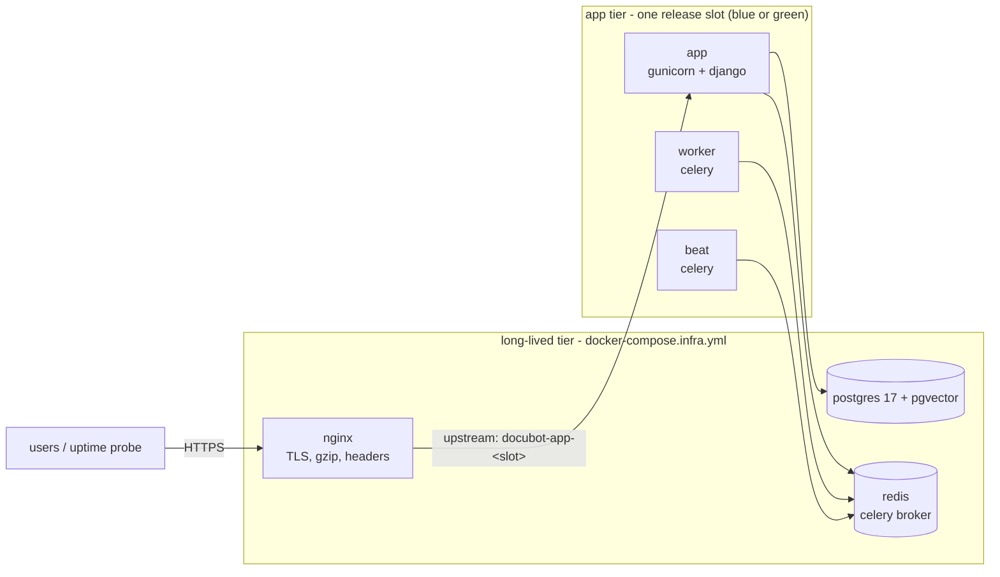

# StackSmith

**deploys this ← [docubot](https://github.com/Abolfazlrwm/docubot)**

Production-grade deployment kit for the docubot stack: docker compose,
zero-downtime deploys, backups, observability. One VPS, no Kubernetes, no
cloud lock-in — everything here runs on a single machine you can ssh into.

## Why this exists

docubot is a real backend — Django 5.2 + DRF + Celery + Postgres/pgvector +
Redis. It deserves a real production path where the boring parts (deploy,
rollback, backup, monitor) are engineered as deliberately as the application
code. StackSmith is that path, and it holds itself to one rule:

> a claim in this README must be proven by a CI job; everything untested is
> written down as a known limitation instead.

## The plan

The kit is built in six phases, each merged as one pull request:

| Phase | What lands | Status |
|---|---|---|
| 0 | skeleton, lint + smoke CI, conventions, ADR-0001 | merged |
| 1 | production compose stack: app, worker, beat, postgres, redis, nginx | this PR |
| 2 | blue-green deploys and one-command rollback | planned |
| 3 | encrypted backups with a tested restore path | planned |
| 4 | observability: prometheus, alert rules, grafana, uptime probe | planned |
| 5 | runbooks, failure playbook, v0.1.0 | planned |

## Architecture

Two compose files split the stack the way the lifecycle splits it: the
long-lived tier (nginx, postgres, redis) never restarts on a release; the
app tier (app, worker, beat) is what a deploy replaces.

- `docker-compose.infra.yml` - nginx, postgres (pgvector/pgvector:pg17),
  redis. Fixed network name (`stacksmith_backend`) and fixed volume names,
  so the app-tier slots can join them.
- `docker-compose.prod.yml` - app, worker, beat. The app image comes from
  `DOCUBOT_IMAGE` (the docubot release); CI runs the same files against a
  contract-equivalent stub image (`tests/stub-app/`) with gunicorn, celery,
  and real `/health/live/` + `/health/ready/` endpoints.
- `docker-compose.override.yml` - local conveniences (debug ports). Loaded
  by `make up`, never by deploys.

The smoke job in CI brings the exact stack up, runs migrations, and probes
both health endpoints through nginx.

## Docs

- [Engineering conventions](docs/conventions.md) — how this repo is built
- [ADR-0001: compose as the deployment unit](docs/adr/0001-use-compose-as-the-deployment-unit.md)

## License

[MIT](LICENSE)
