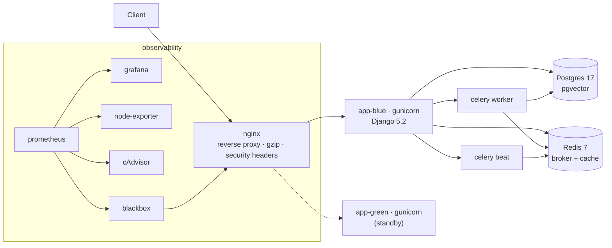

# StackSmith

[](https://github.com/Abolfazlrwm/stacksmith/actions/workflows/lint.yml)
[](https://github.com/Abolfazlrwm/stacksmith/actions/workflows/smoke.yml)
[](https://github.com/Abolfazlrwm/stacksmith/actions/workflows/restore-drill.yml)
[](https://github.com/Abolfazlrwm/stacksmith/actions/workflows/encryption-drill.yml)
[](https://github.com/Abolfazlrwm/stacksmith/actions/workflows/logs-drill.yml)
[](https://github.com/Abolfazlrwm/stacksmith/releases/latest)
[](LICENSE)

**deploys this ← [docubot](https://github.com/Abolfazlrwm/docubot)**

Production-grade deployment kit for the docubot stack: docker compose,
zero-downtime deploys, backups, observability. One VPS, no Kubernetes, no
cloud lock-in — everything here runs on a single machine you can ssh into.

> A claim in this README must be proven by a CI job; everything untested is
> written down as a [known limitation](docs/known-limitations.md) instead.

## Stack



## Quick start

```bash
git clone https://github.com/Abolfazlrwm/stacksmith.git
cd stacksmith
cp .env.example .env          # fill in the required values
make doctor                   # verify the host is ready
make up                       # bring the stack up
make backup                   # take a database backup
```

## What works today (proven in CI)

- **Lint** — `yamllint`, `shellcheck`, `docker compose config` (including TLS overlay) on every push.
- **Smoke (stub)** — nginx + static health page.
- **Smoke (prod)** — full stack up (app, worker, beat, postgres, redis, nginx),
  `/health/live/` and `/health/ready/` probed through nginx.
- **Deploy + rollback drill** — blue → green → blue with canary probes at
  every step. Zero-downtime proven.
- **Canary failure → auto-rollback** — break app-green, verify deploy.sh
  catches it and rolls back automatically.
- **Restore drill** — seed a row, back up, drop the row, restore, verify the
  row count. The backup metric (`backup.prom`) is verified too.
- **Encryption drill** — encrypt a backup with `age`, drop a row, restore
  from the encrypted file, verify the row is back.
- **Logs drill** — bring up Loki + promtail, generate a log line, query Loki
  and verify the log was ingested.

## Known limitations

See [docs/known-limitations.md](docs/known-limitations.md). The v0.2.0
release closes every item from the v0.2 roadmap. What remains:

- Single host (no HA) — deliberate (ADR-0001).
- No automated secret rotation — manual (ADR-0005).
- Tested in CI against a fresh database, not a large production one.

## Architecture decisions

- [ADR-0001: compose as the deployment unit](docs/adr/0001-use-compose-as-the-deployment-unit.md)
- [ADR-0002: blue-green with compose](docs/adr/0002-blue-green-with-compose.md)
- [ADR-0003: dump-based backups over WAL shipping](docs/adr/0003-dump-based-backups-over-wal-shipping.md)
- [ADR-0004: metrics-first, logs-second observability](docs/adr/0004-metrics-first-logs-second-observability.md)
- [ADR-0005: secrets in .env with documented rotation](docs/adr/0005-secrets-in-env-with-documented-rotation.md)
- [ADR-0006: backup freshness as a textfile metric](docs/adr/0006-backup-freshness-as-textfile-metric.md)
- [ADR-0007: off-host encryption with age](docs/adr/0007-off-host-encryption-with-age.md)
- [ADR-0008: canary checks post-switch with auto-rollback](docs/adr/0008-canary-checks-post-switch.md)
- [ADR-0009: Loki as a secondary observability signal](docs/adr/0009-loki-as-secondary-observability.md)
- [ADR-0010: automated TLS with certbot](docs/adr/0010-automated-tls-with-certbot.md)
- [ADR-0011: Alertmanager with severity routing](docs/adr/0011-alertmanager-with-severity-routing.md)
- [ADR-0012: backup integrity verification](docs/adr/0012-backup-integrity-verification.md)
- [ADR-0013: secret rotation with zero downtime](docs/adr/0013-secret-rotation-with-zero-downtime.md)
- [ADR-0014: OpenTelemetry traces to Tempo](docs/adr/0014-opentelemetry-traces-to-tempo.md)
- [ADR-0015: multi-host readiness](docs/adr/0015-multi-host-readiness.md)
- [ADR-0016: automated security scanning](docs/adr/0016-automated-security-scanning.md)
- [ADR-0017: SBOM generation with syft](docs/adr/0017-sbom-generation-with-syft.md)
- [ADR-0018: load testing with k6](docs/adr/0018-load-testing-with-k6.md)
- [ADR-0019: multi-arch registry images](docs/adr/0019-multi-arch-registry-images.md)
- [ADR-0020: cosign image signing](docs/adr/0020-cosign-and-terraform-and-chaos.md)
- [ADR-0021: Terraform provisioning](docs/adr/0020-cosign-and-terraform-and-chaos.md)
- [ADR-0022: chaos engineering drill](docs/adr/0020-cosign-and-terraform-and-chaos.md)
- [ADR-0023: cosign verify gate](docs/adr/0023-cosign-verify-and-disaster-recovery.md)
- [ADR-0024: disaster recovery drill](docs/adr/0023-cosign-verify-and-disaster-recovery.md)
- [ADR-0025: deploy-time cosign verify](docs/adr/0025-deploy-verify-automation-cost.md)
- [ADR-0026: release drafter and Dependabot auto-merge](docs/adr/0025-deploy-verify-automation-cost.md)
- [ADR-0027: cost monitoring dashboard](docs/adr/0025-deploy-verify-automation-cost.md)
- [ADR-0028: multi-provider Terraform](docs/adr/0028-multi-provider-and-architecture.md)
- [ADR-0029: architecture docs and OpenAPI](docs/adr/0028-multi-provider-and-architecture.md)
- [ADR-0030: maintenance, recording rules, health CLI, capacity, audit](docs/adr/0030-operational-excellence.md)

## Architecture

See [docs/architecture.md](docs/architecture.md) for the full system architecture with
five Mermaid diagrams (topology, CI, deploy, backup, firewall).

See [docs/api/health-openapi.json](docs/api/health-openapi.json) for the
OpenAPI 3.0 spec of the health endpoints.

## Runbooks

- [Operations](docs/runbooks/operations.md) — daily, weekly, incident paths
- [Deploy](docs/runbooks/deploy.md) — normal and rollback paths
- [Backup and restore](docs/runbooks/backup-and-restore.md)
- [Failure playbook](docs/runbooks/failure-playbook.md) — disk full, OOM, cert expiry, pg fail, nginx fail

## Layout

```
.
├── docker-compose.prod.yml       # the deployment unit
├── docker-compose.monitoring.yml # observability overlay
├── Makefile                      # one entry point for ops
├── scripts/                      # deploy, rollback, backup, restore, release, env checks
├── app/                          # minimal Django app (health endpoints, migrate entrypoint)
├── nginx/                        # reverse proxy config + upstreams
├── postgres/                     # tuned postgresql.conf
├── monitoring/                   # prometheus, alert rules, blackbox config
├── grafana/                      # provisioned dashboards
├── deploy/systemd/               # backup timer + service units
└── docs/
    ├── adr/                      # 5 ADRs
    ├── runbooks/                 # 4 runbooks
    └── known-limitations.md      # what does not work yet
```

## License

[MIT](LICENSE)
