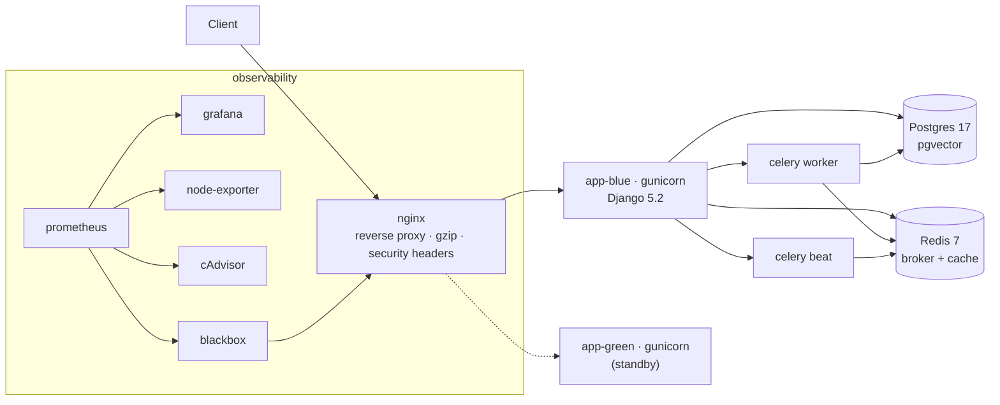

# StackSmith

[](https://github.com/Abolfazlrwm/stacksmith/actions/workflows/lint.yml)
[](https://github.com/Abolfazlrwm/stacksmith/actions/workflows/smoke.yml)
[](https://github.com/Abolfazlrwm/stacksmith/actions/workflows/restore-drill.yml)
[](https://github.com/Abolfazlrwm/stacksmith/releases/latest)
[](LICENSE)

**deploys this ← [docubot](https://github.com/Abolfazlrwm/docubot)**

Production-grade deployment kit for the docubot stack: docker compose,
zero-downtime deploys, backups, observability. One VPS, no Kubernetes, no
cloud lock-in — everything here runs on a single machine you can ssh into.

> A claim in this README must be proven by a CI job; everything untested is
> written down as a [known limitation](docs/known-limitations.md) instead.

## Stack



## Quick start

```bash
git clone https://github.com/Abolfazlrwm/stacksmith.git
cd stacksmith
cp .env.example .env          # fill in the required values
make doctor                   # verify the host is ready
make up                       # bring the stack up
make backup                   # take a database backup
```

## What works today (proven in CI)

- **Lint** — `yamllint`, `shellcheck`, `docker compose config` on every push.
- **Smoke (stub)** — nginx + static health page.
- **Smoke (prod)** — full stack up (app, worker, beat, postgres, redis, nginx),
  `/health/live/` and `/health/ready/` probed through nginx.
- **Deploy + rollback drill** — blue → green → blue with `/health` probes at
  every step. This is the proof that deploys are zero-downtime.
- **Restore drill** — seed a row, back up, drop the row, restore, verify the
  row count is back. A backup that has never been restored is not a backup.

## Known limitations

See [docs/known-limitations.md](docs/known-limitations.md). The short version:
TLS is a template (not automated), no log aggregation, the backup-freshness
metric is not yet written by the backup script, no canary checks post-switch,
no off-host encryption, single host.

## Architecture decisions

- [ADR-0001: compose as the deployment unit](docs/adr/0001-use-compose-as-the-deployment-unit.md)
- [ADR-0002: blue-green with compose](docs/adr/0002-blue-green-with-compose.md)
- [ADR-0003: dump-based backups over WAL shipping](docs/adr/0003-dump-based-backups-over-wal-shipping.md)
- [ADR-0004: metrics-first, logs-second observability](docs/adr/0004-metrics-first-logs-second-observability.md)
- [ADR-0005: secrets in .env with documented rotation](docs/adr/0005-secrets-in-env-with-documented-rotation.md)

## Runbooks

- [Operations](docs/runbooks/operations.md) — daily, weekly, incident paths
- [Deploy](docs/runbooks/deploy.md) — normal and rollback paths
- [Backup and restore](docs/runbooks/backup-and-restore.md)
- [Failure playbook](docs/runbooks/failure-playbook.md) — disk full, OOM, cert expiry, pg fail, nginx fail

## Layout

```
.
├── docker-compose.prod.yml       # the deployment unit
├── docker-compose.monitoring.yml # observability overlay
├── Makefile                      # one entry point for ops
├── scripts/                      # deploy, rollback, backup, restore, release, env checks
├── app/                          # minimal Django app (health endpoints, migrate entrypoint)
├── nginx/                        # reverse proxy config + upstreams
├── postgres/                     # tuned postgresql.conf
├── monitoring/                   # prometheus, alert rules, blackbox config
├── grafana/                      # provisioned dashboards
├── deploy/systemd/               # backup timer + service units
└── docs/
    ├── adr/                      # 5 ADRs
    ├── runbooks/                 # 4 runbooks
    └── known-limitations.md      # what does not work yet
```

## License

[MIT](LICENSE)
