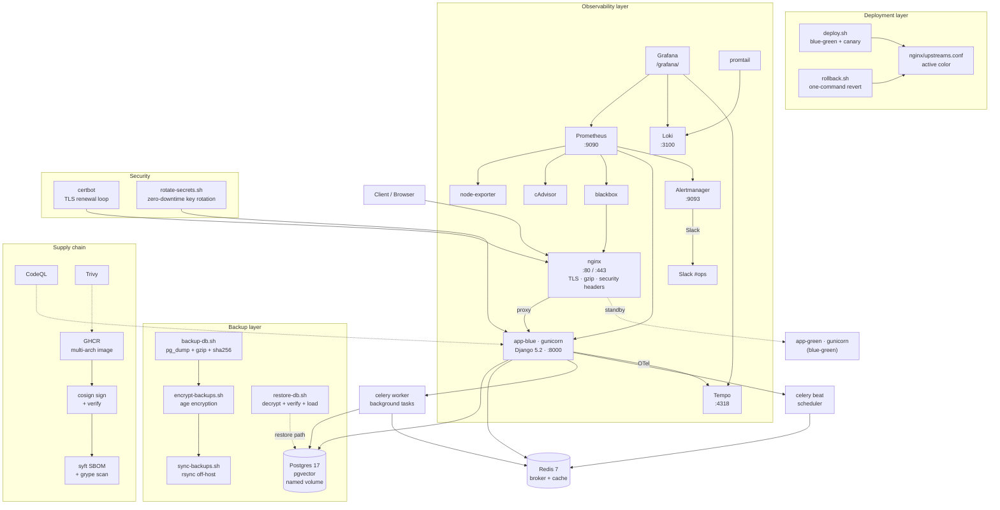
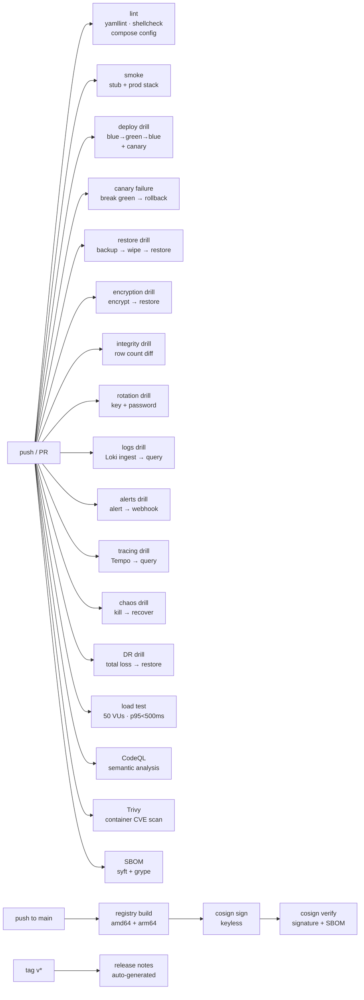
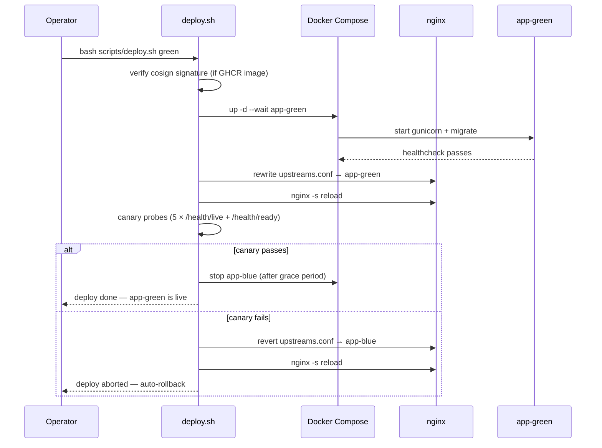

# System architecture

This document describes the architecture of the stacksmith deployment kit,
the services it manages, and the data paths between them.

## High-level topology



## Service inventory

| Service | Image | Port | Healthcheck | Purpose |
|---|---|---|---|---|
| app-blue | stacksmith/app:latest | 8000 | curl /health/live/ | Primary Django app (gunicorn) |
| app-green | stacksmith/app:latest | 8000 | curl /health/live/ | Standby for blue-green deploy |
| worker | stacksmith/app:latest | — | — | Celery worker (background tasks) |
| beat | stacksmith/app:latest | — | — | Celery beat scheduler |
| postgres | pgvector/pgvector:pg17 | 5432 | pg_isready | Database + pgvector |
| redis | redis:7-alpine | 6379 | redis-cli ping | Broker + cache |
| nginx | nginx:1.27-alpine | 80, 443 | wget /health/live/ | Reverse proxy, TLS, gzip |

## Observability inventory

| Service | Image | Port | Purpose |
|---|---|---|---|
| prometheus | prom/prometheus | 9090 | Metrics scraper + alert evaluation |
| grafana | grafana/grafana | 3000 (via nginx /grafana/) | Dashboards (5 provisioned) |
| loki | grafana/loki | 3100 | Log storage (14-day retention) |
| promtail | grafana/promtail | — | Docker log scraper → Loki |
| tempo | grafana/tempo | 4318 (OTLP) | Trace storage (7-day retention) |
| alertmanager | prom/alertmanager | 9093 | Alert routing (Slack) |
| node-exporter | prom/node-exporter | 9100 | Host metrics |
| cAdvisor | gcr.io/cadvisor | 8080 | Container metrics |
| blackbox | prom/blackbox-exporter | 9115 | HTTP probe for /health |

## CI pipeline (24 workflows)



## Data flow: deploy



## Data flow: backup + disaster recovery

```mermaid
sequenceDiagram
    participant cron as systemd timer
    participant backup as backup-db.sh
    participant encrypt as encrypt-backups.sh
    participant sync as sync-backups.sh
    participant pg as Postgres
    participant off as Off-host destination
    participant metric as textfile metric

    cron->>backup: nightly 03:00
    backup->>pg: pg_dump --clean --if-exists
    pg-->>backup: SQL stream
    backup->>backup: gzip + sha256
    backup->>metric: write backup.prom (timestamp, size, status)
    backup->>encrypt: age encrypt with public key
    encrypt->>sync: rsync only .age files
    sync->>off: encrypted backup delivered
```

## Firewall rules

| Port | Protocol | Source | Purpose |
|---|---|---|---|
| 22 | TCP | 0.0.0.0/0 | SSH |
| 80 | TCP | 0.0.0.0/0 | HTTP (ACME + redirect) |
| 443 | TCP | 0.0.0.0/0 | HTTPS |
| 3000 | TCP | 0.0.0.0/0 | Grafana (restrict in production) |

All other ports are closed. Internal container communication uses the
Docker bridge network (no host port exposure).
